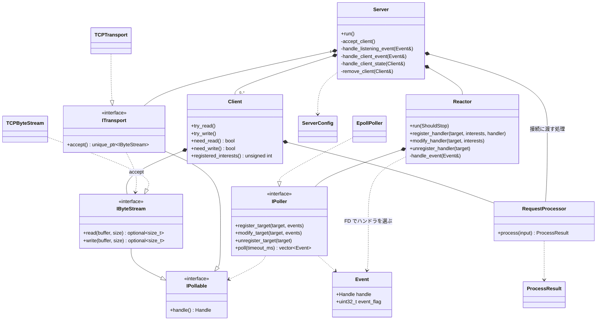

# Architecture

`main` は `TCPTransport`、`EpollPoller`、JSON RPC 用の `RequestProcessor`、停止条件を `ServerConfig` に渡します。`Server` は待ち受けソケットと接続を所有し、`Reactor` はポーラーと FD ごとのイベントハンドラを所有します。

## モジュール構成

- `Handle` は `int` の別名で、TCP ではソケットの FD です。`IPoller` は読み取り可能・書き込み可能・エラーを `Event::event_flag` で返します。
- `Reactor` は FD と `EventHandler`（`std::function<void(Event&)>`）の対応を保持します。監視登録が失敗した場合は追加したハンドラを取り消し、監視解除時は対応するハンドラも削除します。
- `Client` は接続ごとのバイトストリーム、受信・送信バッファ、読み取り状態、登録済みの監視マスクを持ちます。
- `RequestProcessor` は注入された `Parser` を呼びます。`ProcessResult` は `Processed`（応答と消費バイト数）、`NeedMore`（追加受信待ち）、`Discard`（破棄するバイト数）のいずれかです。

## イベントの流れ

1. `Server::run()` が待ち受け FD とハンドラを `Reactor` に登録し、停止条件を渡してイベントループを起動します。
2. `Reactor` が `IPoller::poll()` で待機し、通知された FD に対応するハンドラを呼びます。
3. 待ち受け FD が読み取り可能になると、`Server` が接続を受け付け、新しい `Client` と接続用ハンドラを登録します。
4. 接続用ハンドラは通知に応じて `Client` の読み書きを行います。受信したバイト列は `RequestProcessor` に渡され、応答があれば送信バッファに追加されます。
5. `Server` は `Client` の状態から次の監視マスクを決め、変更があれば `Reactor` に反映を依頼します。接続を閉じる場合は `Reactor` で監視とハンドラを解除してから `Client` を破棄します。
